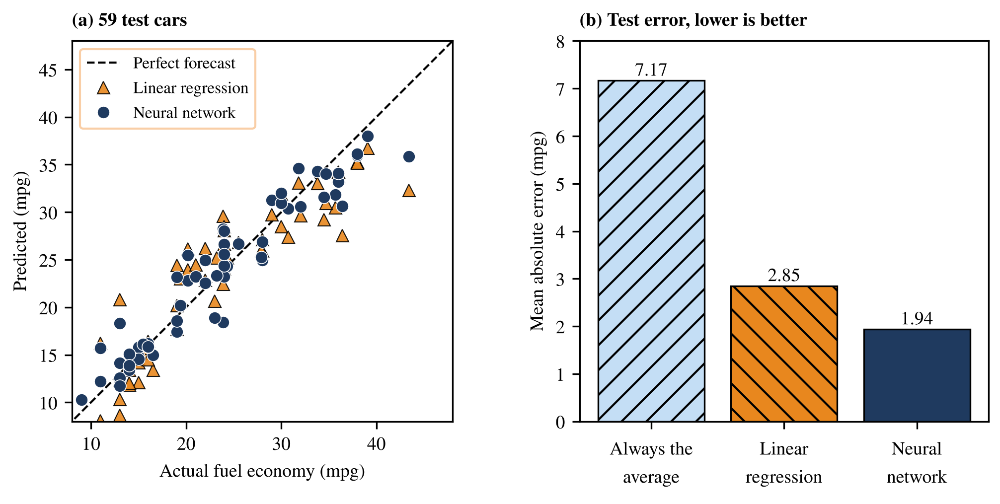

# Project 2: Predicting fuel economy of cars

A regression network predicts a car's miles per gallon from its weight, power and other specifications. It is compared with two honest baselines: guessing the average, and a linear model.

## How to run

Set the MATLAB working directory to this folder and run:

```matlab
>> Evaluate_Cars
```


## What is in this folder

| File | What it does |
|---|---|
| `Split_Cars.m` | Splits 392 cars 274 / 59 / 59. |
| `Training_Cars.m` | Trains with early stopping. The linear model uses `pinv(train_Input) * train_Output`. |
| `Evaluate_Cars.m` | Runs training, then compares the network with both baselines. |
| `BackPropagation_Regression.m` | Back-propagation for a linear output with squared error. |
| `Mean_Squared_Loss.m` | The loss used for early stopping. |
| `ReLU.m` | Activation function. |
| `cars.csv` | The data. |

## What you should see

Training stops at epoch 71 and the best weights come from epoch 41. Mean absolute error on the 59 test cars: guessing the average 7.17 mpg, linear model 2.85 mpg, neural network 1.94 mpg. The network's R² is 0.909.

## Figures made from these results



---
[Back to the main page](../../../README.md) · [Chapter list](../../../README.md#chapter-guide)
