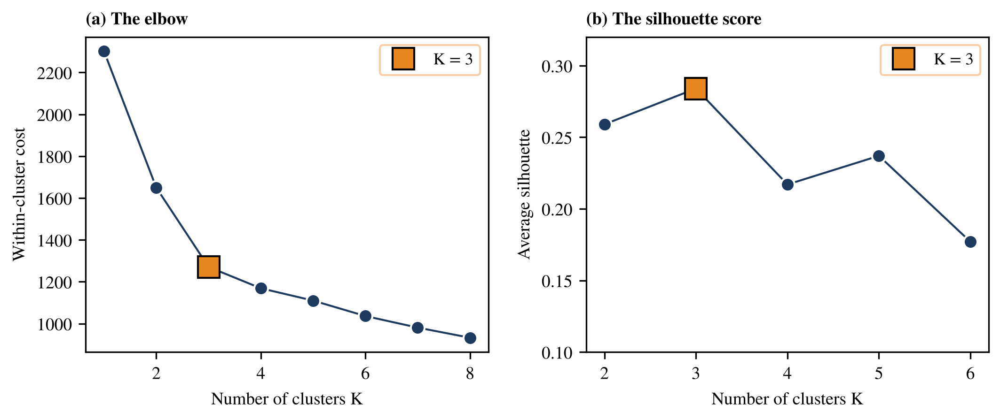
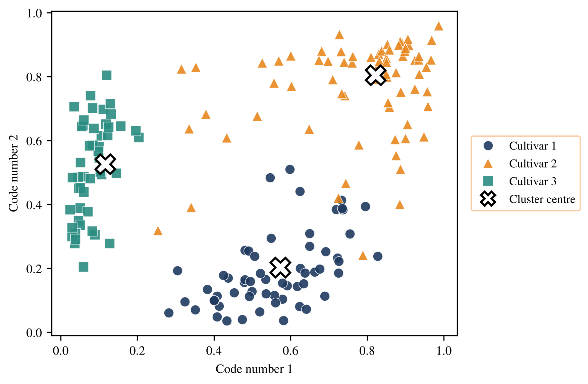

# Project 3: Grouping wines with K-means and an autoencoder

Unsupervised learning on 178 wines described by 13 chemical measurements. K-means groups the wines without seeing the grape variety. An autoencoder then squeezes the 13 numbers into two, and K-means is repeated.

## How to run

Set the MATLAB working directory to this folder and run:

```matlab
>> Clustering_Wine      % then, for the autoencoder version:  Autoencoder_Wine
```


## What is in this folder

| File | What it does |
|---|---|
| `Load_Wine.m` | Loads and standardises the data. |
| `Clustering_Wine.m` | Elbow plot, silhouette scores and clusters for K = 2 to 6, then K = 3. |
| `Autoencoder_Wine.m` | Compresses the wines to two numbers and clusters again. |
| `KMeans.m` | The K-means function. |
| `Purity.m` | Compares clusters with the true cultivars. |
| `Silhouette.m` | Silhouette score of a clustering. |
| `BackPropagation_Compress.m` | Training function for the compressing autoencoder. |
| `Sigmoid.m` | Activation function. |
| `wine.csv` | The data. |

## What you should see

The K-means cost for K = 1 to 8 is 2301.0, 1649.4, 1270.7, 1168.8, 1110.0, 1036.2, 981.0 and 932.7. Silhouette scores for K = 2 to 6: 0.259, 0.284, 0.217, 0.237, 0.177, so K = 3 is best. With K = 3, the clusters match the cultivars in 97.2% of wines (confusion rows `[59 2 0]`, `[0 66 0]`, `[0 3 48]`). After the autoencoder, the purity is 93.8%.

## Figures made from these results





---
[Back to the main page](../../../README.md) · [Chapter list](../../../README.md#chapter-guide)
