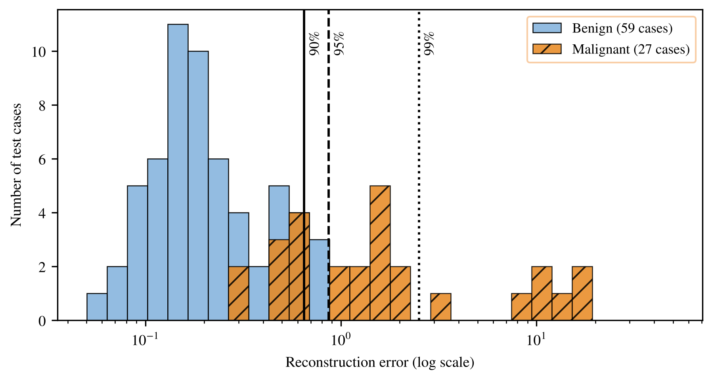

# Project 6: Anomaly detection

An autoencoder is trained on **benign** tumours only. A malignant tumour looks strange to it, so its reconstruction error is large. The threshold is chosen from the validation set, not the test set.

## How to run

Set the MATLAB working directory to this folder and run:

```matlab
>> Evaluate_Anomaly
```


## What is in this folder

| File | What it does |
|---|---|
| `Split_Anomaly.m` | Training: 247 benign. Validation: 51 benign and 34 malignant. Test: 59 benign and 27 malignant. |
| `Training_Anomaly.m` | Trains the autoencoder on benign tumours with early stopping. |
| `Evaluate_Anomaly.m` | Runs training and tests three thresholds. |
| `BackPropagation_Anomaly.m` | Back-propagation for the autoencoder. |
| `Reconstruction_Error.m` | Error of each sample. |
| `Confusion_Matrix.m` | Counts TP, FP, FN, TN. |
| `ReLU.m` | Activation function. |
| `cancer.csv` | The data. |

## What you should see

The mean test error is 0.261 for benign and 3.833 for malignant tumours.

| Threshold | Value | Malignant caught (of 27) | False alarms (of 59) |
|---|---|---|---|
| 90th percentile | 0.648 | 18 | 3 |
| 95th percentile | 0.867 | 18 | 0 |
| 99th percentile | 2.506 | 7 | 0 |

## Figures made from these results



---
[Back to the main page](../../../README.md) · [Chapter list](../../../README.md#chapter-guide)
