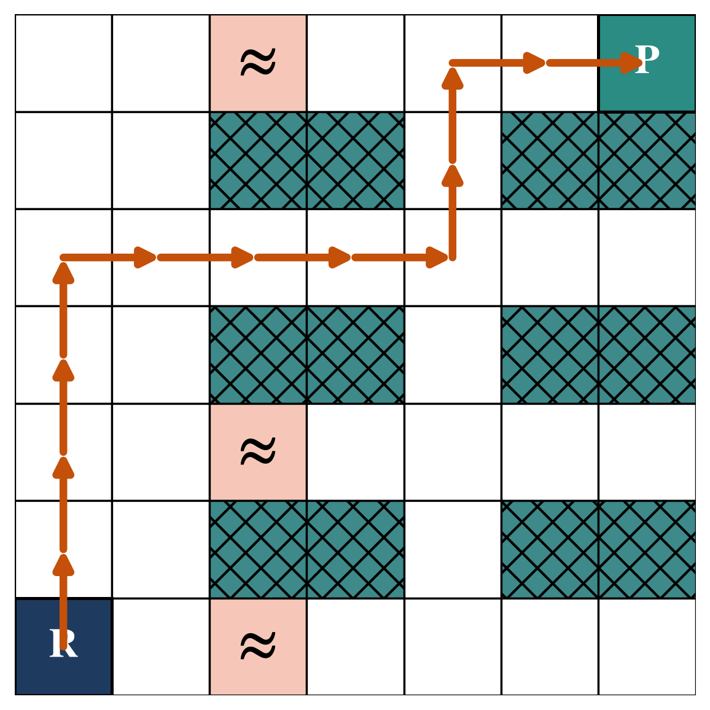
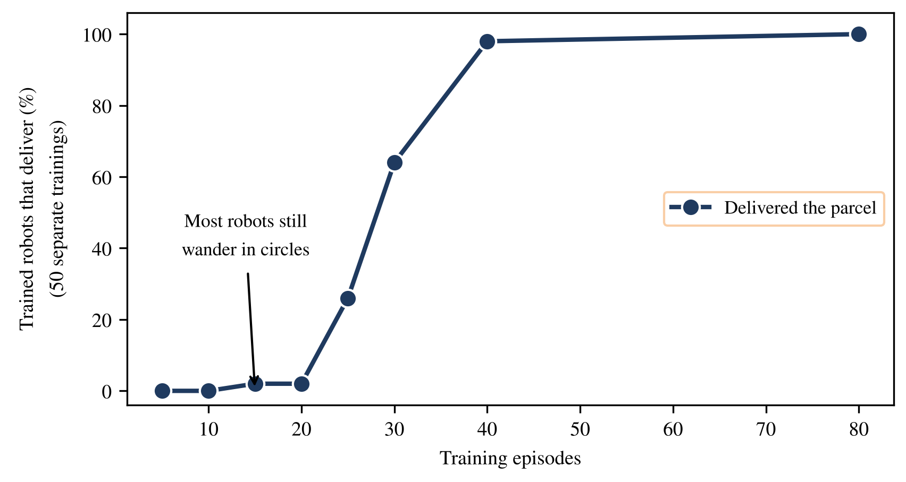

# Project 7: A warehouse robot

A robot learns by Q-learning to reach the packing station in a 7×7 warehouse with shelves and spills. The script measures how many training episodes the robot needs before it can solve the task.

## How to run

Set the MATLAB working directory to this folder and run:

```matlab
>> Evaluate_Warehouse
```


## What is in this folder

| File | What it does |
|---|---|
| `Warehouse.m` | The environment: shelves, spills, rewards. |
| `QLearning_Warehouse.m` | One episode of Q-learning with epsilon-greedy exploration. |
| `Training_Warehouse.m` | Trains the robot. |
| `Run_Policy.m` | Runs the greedy or a random policy and reports the outcome. |
| `Budget_Warehouse.m` | Delivery rate against the number of training episodes. |
| `Evaluate_Warehouse.m` | Runs everything and shows the route. |

## What you should see

Over 50 random seeds, the share of runs that deliver to the station after a training budget of 5, 10, 15, 20, 25, 30, 40 and 80 episodes is 0, 0, 2%, 2%, 26%, 64%, 98% and 100%. Below about 20 episodes, the robot almost never finds the station, so the reward has nothing to spread from.

## Figures made from these results





---
[Back to the main page](../../../README.md) · [Chapter list](../../../README.md#chapter-guide)
