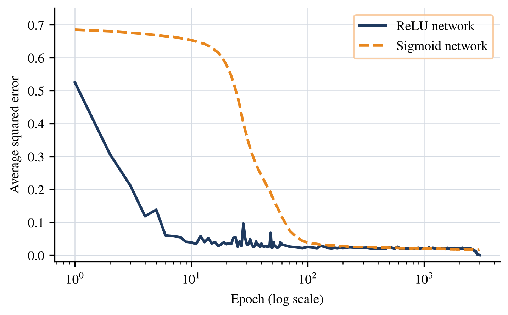
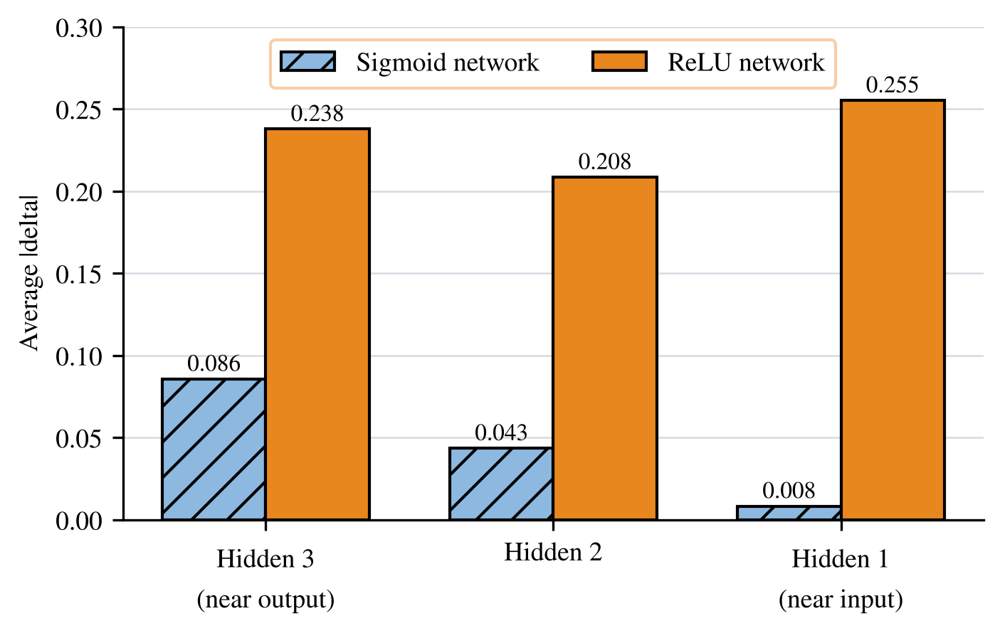

# Chapter 5: Deep learning with ReLU, dropout and the vanishing gradient

Networks with several hidden layers, and the three ideas that make them trainable: the ReLU activation, dropout, and an understanding of why gradients vanish in deep sigmoid networks. All experiments use the Iris data.

## How to run

```matlab
>> Compare_Activations   % ReLU against sigmoid, self-contained
>> Gradient_Size         % size of the delta in each layer, self-contained
>> Dropout_Test          % plain against dropout networks, self-contained
```

## What is in this folder

| File | What it does |
|---|---|
| `Compare_Activations.m` | Trains a deep ReLU network and a deep sigmoid network and records the training error. |
| `Gradient_Size.m` | Measures the average delta in each hidden layer for both networks. |
| `Dropout_Test.m` | Trains plain and dropout networks and tests them on increasingly noisy data. |
| `BackPropagation_DeepReLU.m` | Back-propagation for the four-weight-matrix ReLU network. |
| `BackPropagation_DeepSigmoid.m` | The same for the sigmoid network. |
| `BackPropagation_Dropout.m` | The same with dropout in the hidden layers. |
| `Dropout.m` | Creates the random dropout mask. |
| `ReLU.m, Sigmoid.m, Softmax.m` | Activation functions. |
| `iris.csv` | The data. |

## What you should see

Training error of the ReLU network against the sigmoid network (the training error is the average over the training set):

| Epoch | ReLU | Sigmoid |
|---|---|---|
| 1 | 0.5245 | 0.6849 |
| 10 | 0.0387 | 0.6528 |
| 50 | 0.0231 | 0.1746 |
| 100 | 0.0244 | 0.0380 |
| 500 | 0.0244 | 0.0221 |
| 1000 | 0.0206 | 0.0204 |
| 3000 | 0.0003 | 0.0161 |

Average delta by layer (layer 3 is nearest the output): sigmoid 0.0856, 0.0434 and 0.0082 for layers 3, 2 and 1, so the signal shrinks towards the input. ReLU gives 0.2377, 0.2084 and 0.2551, so it holds steady.

The dropout experiment is random. Over five runs the plain network scores 99.7% / 83.4% / 68.8% on clean / medium-noise / high-noise data and the dropout network scores 84.9% / 72.2% / 62.1%. In one run the dropout network collapsed to 33.3%. The book discusses this openly.

## Figures made from these results





---
[Back to the main page](../../README.md) · [Chapter list](../../README.md#chapter-guide)
