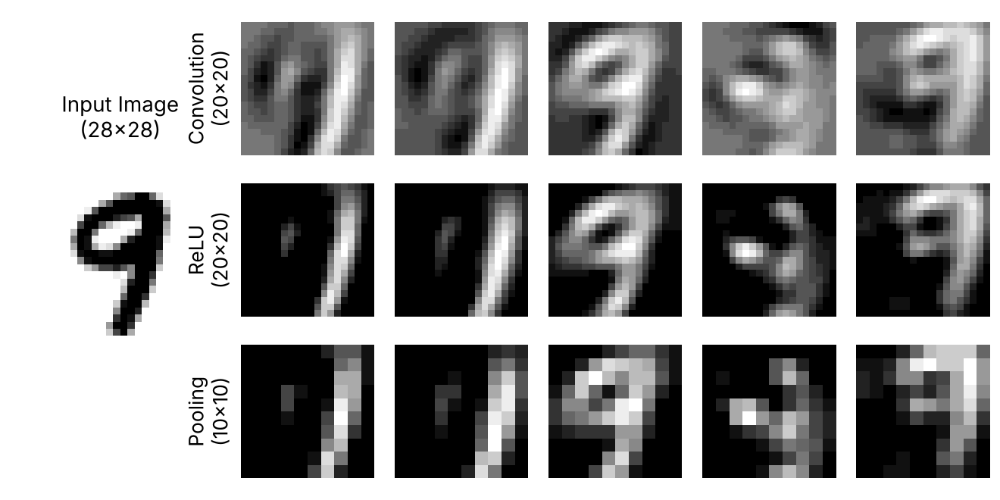

# Chapter 6: Convolutional neural network on MNIST handwritten digits

A complete convolutional network built from nothing but `conv2`: 20 convolution filters (9×9), ReLU, mean pooling, a hidden layer and a softmax output. It trains on 8,000 MNIST test images and is tested on the other 2,000.

## How to run

**One-off setup.** The MNIST files are downloaded, not stored here. From any folder, run:

```matlab
>> setup_mnist     % in the Code folder; creates Chapter_6/MNIST and Chapter_7/MNIST
```

Then:

```matlab
>> Training_CNN    % about 30 seconds in MATLAB Online, saves CNN_Trained.mat
>> Testing_CNN
```

## What is in this folder

| File | What it does |
|---|---|
| `Training_CNN.m` | Trains for 3 epochs on 8,000 images with `rng(1)`, then saves `CNN_Trained.mat`. |
| `Testing_CNN.m` | Tests the trained network on the 2,000 held-out images and prints the accuracy. |
| `BackPropagation_CNN.m` | Back-propagation through the pooling, ReLU and convolution layers. |
| `Conv.m` | The convolution layer (calls `conv2`). |
| `Pool.m` | Mean pooling. |
| `ReLU.m, Softmax.m` | Activation functions. |
| `LoadMNISTImages.m, LoadMNISTLabels.m` | Read the MNIST binary files. |

## What you should see

`Testing_CNN` prints `Accuracy = 0.935000`: 1,870 of the 2,000 test images are classified correctly.

## Figures made from these results



---
[Back to the main page](../../README.md) · [Chapter list](../../README.md#chapter-guide)
